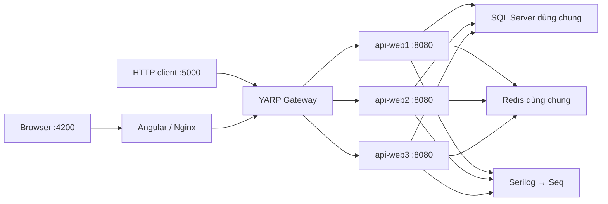

# ProductCRUD

Ứng dụng quản lý sản phẩm được phát triển trong quá trình thực tập, sử dụng **ASP.NET Core .NET 9**, **Angular 18**, **SQL Server**, **Redis**, **YARP**, **Serilog** và **Seq**.

Bản triển khai Docker hiện tại có **3 API container dùng chung một image**, một Redis, một Gateway và một Seq. Frontend truy cập API qua Gateway; dữ liệu nghiệp vụ được lưu trong SQL Server.

## Chức năng

- **Sản phẩm:** xem danh sách và chi tiết; thêm, sửa, xóa mềm; tìm kiếm theo mã hoặc tên; lọc trạng thái; phân trang và sắp xếp.
- **Danh mục:** API CRUD, cache danh sách bằng Redis, xóa cache sau khi thêm/sửa/xóa thành công.
- **Xác thực và phân quyền:** JWT, ba vai trò Admin/Editor/Viewer, Route Guard và điều khiển hiển thị chức năng theo quyền.
- **Audit log:** ghi lịch sử thao tác sản phẩm bằng Entity Framework interceptor, Channel và BackgroundService; Admin được tra cứu lịch sử.
- **Upload:** JPG/JPEG/PNG/PDF, mặc định tối đa 5 MB; kiểm tra định dạng, dung lượng và chữ ký tệp; hiển thị tiến trình trên Angular.
- **Xử lý lỗi:** middleware trả lỗi có cấu trúc; frontend gắn JWT, hiển thị Toast và chuyển về đăng nhập khi phiên không hợp lệ.
- **Triển khai:** Docker Compose, chia sẻ cache và tệp upload giữa các API, cân bằng tải RoundRobin, health check và log có InstanceId.
- **CI:** tự động build frontend, API, Gateway và các Docker image bằng GitHub Actions.

## Kiến trúc Docker



Ba service `api-web1`, `api-web2`, `api-web3` cùng build từ [Dockerfile API](backend/ProductCrud.Api/Dockerfile), cùng image `productcrud-api:week-scale`. Cấu hình chung được khai báo bằng `x-api-common` trong [docker-compose.yml](docker-compose.yml).

- API kết nối Redis bằng `redis:6379`, SQL Server bằng `sqlserver:1433` và Seq bằng `http://seq:5341`.
- Gateway chuyển tiếp tới `http://api-web1:8080/`, `http://api-web2:8080/`, `http://api-web3:8080/`.
- Frontend Nginx chuyển `/api/` và `/uploads/` tới `gateway:8080`.
- Host port 5001–5003 dùng để truy cập trực tiếp từng API từ máy phát triển. Trong Docker network, các service dùng tên service và container port.
- Container port API hiện là **8080**, phù hợp với Dockerfile và `ASPNETCORE_URLS=http://+:8080`.

### Công nghệ

| Thành phần       | Công nghệ                                    |
| ---------------- | -------------------------------------------- |
| Frontend         | Angular 18.2, TypeScript 5.5, RxJS           |
| Backend          | ASP.NET Core .NET 9, Entity Framework Core 9 |
| Database         | SQL Server 2022                              |
| Cache            | Redis 7, IDistributedCache                   |
| Gateway          | Yarp.ReverseProxy 2.3.0                      |
| Logging          | Serilog, Serilog.Sinks.Seq, Seq 2026.1       |
| Triển khai và CI | Docker Compose, Nginx, GitHub Actions        |

## Chạy bằng Docker Compose

### Chuẩn bị

Cài Git, Docker Desktop với Linux containers và Docker Compose. Chạy các lệnh từ thư mục gốc có `docker-compose.yml`.

```powershell
git clone https://github.com/Jurgo001/Project_ThucTap_ASP.Net.git ProductCRUD
cd ProductCRUD
Copy-Item .env.example .env
```

Sửa hai biến trong `.env` bằng giá trị riêng:

```dotenv
SA_PASSWORD=Replace_with_a_strong_SQL_password_123!
JWT_KEY=Replace_with_a_random_key_of_at_least_32_ASCII_characters
```

Các giá trị trên chỉ là ví dụ. Mật khẩu SQL Server cần đáp ứng chính sách mật khẩu; JWT key cần ít nhất 32 byte cho cấu hình HMAC-SHA256 hiện tại. `.env` đã được Git bỏ qua. Nếu sử dụng SQL volume có sẵn, `SA_PASSWORD` phải khớp với mật khẩu đã cấu hình cho SQL Server đó.

### Khởi tạo database lần đầu

API tự chạy migration và tạo tài khoản mẫu nếu bảng người dùng chưa có dữ liệu. Với database mới, khởi động một API trước để tránh ba instance cùng thực hiện bước seed:

```powershell
docker compose up -d --build sqlserver redis seq api-web1
docker compose logs -f api-web1
```

Đợi API khởi động và xuất hiện log `Now listening on`. Nhấn **Ctrl+C** để thoát chế độ xem log, sau đó kiểm tra:

```powershell
Invoke-WebRequest -Uri http://localhost:5001/health -UseBasicParsing
```

Khi nhận HTTP 200, khởi động toàn bộ hệ thống:

```powershell
docker compose up -d --build
docker compose ps
```

Những lần chạy sau, dùng trực tiếp `docker compose up -d --build`. Compose hiện có **8 service**: frontend, gateway, api-web1, api-web2, api-web3, sqlserver, redis và seq.

> `deploy.ps1` còn tham chiếu service `api` và các cổng cũ 5081/5082/5342. Với cấu hình ba API hiện tại, sử dụng các lệnh Compose ở trên cho đến khi script được cập nhật.

### Địa chỉ truy cập

| Thành phần         | Địa chỉ từ máy host                  | Container port |
| ------------------ | ------------------------------------ | -------------: |
| Frontend           | http://localhost:4200                |             80 |
| Gateway API        | http://localhost:5000/api/Categories |           8080 |
| API web1 / Swagger | http://localhost:5001/swagger        |           8080 |
| API web2 / Swagger | http://localhost:5002/swagger        |           8080 |
| API web3 / Swagger | http://localhost:5003/swagger        |           8080 |
| Seq UI             | http://localhost:8081                |             80 |
| Seq ingestion      | http://localhost:5341                |           5341 |
| SQL Server         | localhost:1433                       |           1433 |
| Redis              | localhost:6379                       |           6379 |

API cần JWT ngoại trừ đăng nhập và `/health`. Gateway chỉ có route `/api/{**catchAll}` và `/uploads/{**catchAll}`: truy cập `http://localhost:5000/`, `/swagger` hoặc `/health` sẽ không vào các route đó. Dùng Swagger và health endpoint trực tiếp ở từng API.

### Dữ liệu lưu trữ

| Volume           | Nội dung                                              |
| ---------------- | ----------------------------------------------------- |
| `sqlserver_data` | Dữ liệu SQL Server                                    |
| `seq_data`       | Dữ liệu Seq                                           |
| `api_uploads`    | Thư mục `/app/wwwroot/uploads` dùng chung giữa ba API |

`docker compose down` dừng và xóa container/network, giữ các named volume. Thêm tùy chọn `-v` sẽ xóa các volume và dữ liệu tương ứng.

## Tài khoản và phân quyền

Khi bảng người dùng chưa có dữ liệu, ứng dụng tạo các tài khoản phục vụ môi trường thực tập:

| Username | Password     | Quyền                                      |
| -------- | ------------ | ------------------------------------------ |
| `admin`  | `Admin@123`  | Xem, thêm, sửa, xóa; upload; xem audit log |
| `editor` | `Editor@123` | Xem, thêm, sửa; upload                     |
| `viewer` | `Viewer@123` | Xem sản phẩm và danh mục                   |

Mật khẩu được lưu dưới dạng hash bằng `PasswordHasher`. Backend kiểm tra quyền bằng `Authorize`; frontend dùng `authGuard`, `roleGuard` và ẩn/hiện nút theo vai trò. Các tài khoản mẫu dành cho môi trường thực hành.

## API chính

| Phương thức | Endpoint                                  | Quyền                 |
| ----------- | ----------------------------------------- | --------------------- |
| POST        | `/api/Authorization/Login`                | Không cần đăng nhập   |
| GET         | `/api/ProductManagement/GetAll`           | Admin, Editor, Viewer |
| GET         | `/api/ProductManagement/GetById/{id}`     | Admin, Editor, Viewer |
| POST        | `/api/ProductManagement/Create`           | Admin, Editor         |
| PUT         | `/api/ProductManagement/Update`           | Admin, Editor         |
| DELETE      | `/api/ProductManagement/Delete/{id}`      | Admin                 |
| GET         | `/api/Categories`, `/api/Categories/{id}` | Đã đăng nhập          |
| POST, PUT   | `/api/Categories`                         | Admin, Editor         |
| DELETE      | `/api/Categories/{id}`                    | Admin                 |
| POST        | `/api/Files/Upload`                       | Admin, Editor         |
| GET         | `/api/AuditLogs/GetAll`                   | Admin                 |
| GET         | `/health` trên từng API                   | Không cần đăng nhập   |

Danh sách sản phẩm nhận các query parameter `keyword`, `isActive`, `pageIndex`, `pageSize`, `sortField`, `sortDirection`. `pageSize` được giới hạn tối đa 100. Ví dụ:

```text
GET /api/ProductManagement/GetAll?pageIndex=1&pageSize=5&sortField=Price&sortDirection=asc
```

`PUT /api/Categories` nhận `id` trong JSON body, cùng `categoryName` và `isActive`. Danh sách danh mục chỉ trả các mục đang hoạt động và chưa bị xóa.

Upload sử dụng multipart/form-data với trường `file`. Tệp được lưu bằng tên GUID và trả về đường dẫn `/uploads/{fileName}`.

## Redis shared cache

Category sử dụng cache-aside với khóa thực tế **`ProductCrud:categories:all`**, thời gian hết hạn **10 phút**:

```text
GET Categories → Redis HIT → trả dữ liệu cache
GET Categories → Redis MISS → đọc SQL → ghi Redis → trả dữ liệu
POST / PUT / DELETE thành công → lưu SQL → xóa khóa cache
```

`CategoryService` dùng `ICacheService`; bản triển khai hiện tại đăng ký `RedisCacheService` thông qua `IDistributedCache`. `MemoryCacheService` được giữ trong mã nguồn từ giai đoạn trước và không phải cache đang được đăng ký cho bản Docker hiện tại.

Các thông điệp log phục vụ kiểm tra:

- `REDIS MISS - Query Categories from database`
- `REDIS HIT - Categories`
- `REDIS INVALIDATED - Categories`

Kiểm tra Redis:

```powershell
docker compose exec -T redis redis-cli PING
docker compose exec -T redis redis-cli EXISTS "ProductCrud:categories:all"
docker compose exec -T redis redis-cli TTL "ProductCrud:categories:all"
```

`TTL = -2` nghĩa là khóa không tồn tại tại thời điểm kiểm tra; có thể khóa chưa được tạo, vừa hết hạn hoặc vừa bị xóa. Đây không phải mã lỗi kết nối Redis.

## YARP và health check

Route API và cluster `apiCluster` được nạp từ [appsettings.json](backend/ProductCrud.Gateway/appsettings.json). Trong Docker, Compose ghi đè địa chỉ destination, bổ sung đủ ba API và đặt `LoadBalancingPolicy=RoundRobin`.

Active health check gọi `/health` mỗi **2 giây**, timeout **1 giây**, chính sách `ConsecutiveFailures`, ngưỡng **1 lần thất bại**. Destination không khỏe được loại khỏi tập đích sau khi Gateway phát hiện lỗi; được xét lại khi phục hồi.

`/health` hiện kiểm tra khả năng phục vụ HTTP của tiến trình API, chưa kiểm tra readiness riêng của SQL Server và Redis. Gateway chưa có retry request sang destination khác: trong khoảng thời gian API vừa dừng nhưng health check chưa phát hiện, vẫn có thể gặp 502. Retry GET tại Angular HttpInterceptor chỉ áp dụng cho client Angular, không áp dụng cho Postman.

## Logging tập trung với Seq

Một Seq nhận log từ cả ba API tại `http://seq:5341`. Serilog ghi log console và Seq, bổ sung:

```csharp
.Enrich.FromLogContext()
.Enrich.WithProperty("InstanceId", Environment.MachineName)
```

Compose đặt `hostname` là `api-web1`, `api-web2`, `api-web3`, nên log có tên instance tương ứng. `UseSerilogRequestLogging()` ghi thông tin request như `RequestMethod`, `RequestPath`, `StatusCode` và thời gian xử lý.

Mở http://localhost:8081 và lọc:

```text
InstanceId = 'api-web1'
```

Hoặc đối chiếu các request danh mục:

```text
RequestPath = '/api/Categories' and RequestMethod = 'GET'
```

Seq hiện được cấu hình không yêu cầu đăng nhập trong môi trường phát triển, host port UI và ingestion chỉ bind vào `127.0.0.1`.

## Kiểm tra luồng tích hợp

Các lệnh dưới đây chạy trong **cùng một phiên PowerShell**. Phần kiểm tra cache tạo một danh mục demo trong database; phần chịu lỗi tạm dừng web2 rồi khởi động lại.

### Đăng nhập lấy JWT

```powershell
$loginBody = @{
    username = "admin"
    password = "Admin@123"
} | ConvertTo-Json

$login = Invoke-RestMethod -Method Post -Uri "http://localhost:5000/api/Authorization/Login" -ContentType "application/json" -Body $loginBody
$headers = @{ Authorization = "Bearer $($login.data.token)" }
```

### Kiểm tra RoundRobin

```powershell
1..9 | ForEach-Object {
    $response = Invoke-WebRequest -Uri "http://localhost:5000/api/Categories" -Headers $headers -UseBasicParsing
    [pscustomobject]@{ Request = $_; Status = [int]$response.StatusCode }
}
docker compose logs --since 2m gateway | Select-String "Proxying to"
```

Đối chiếu log Gateway và thuộc tính `InstanceId` trên Seq để xác nhận cả ba API nhận request. Điểm bắt đầu của vòng phân phối có thể là bất kỳ instance nào, tùy các request đã được gửi trước đó.

### Kiểm tra shared cache và invalidation xuyên instance

```powershell
docker compose exec -T redis redis-cli DEL "ProductCrud:categories:all"

# web1 tạo cache; web3 đọc lại dữ liệu cache dùng chung.
Invoke-RestMethod -Uri "http://localhost:5001/api/Categories" -Headers $headers | Out-Null
Invoke-RestMethod -Uri "http://localhost:5003/api/Categories" -Headers $headers | Out-Null

# Thêm danh mục qua web1.
$categoryBody = @{
    categoryName = "SharedCacheDemo-$(Get-Date -Format yyyyMMddHHmmss)"
    isActive = $true
} | ConvertTo-Json
$created = Invoke-RestMethod -Method Post -Uri "http://localhost:5001/api/Categories" -Headers $headers -ContentType "application/json" -Body $categoryBody

# Ngay sau POST, khóa cache cần không tồn tại nếu chưa có GET khác.
docker compose exec -T redis redis-cli EXISTS "ProductCrud:categories:all"
docker compose exec -T redis redis-cli TTL "ProductCrud:categories:all"

# web3 đọc SQL, nhận danh mục mới và tạo cache lại; GET tiếp theo đọc HIT.
$categories = Invoke-RestMethod -Uri "http://localhost:5003/api/Categories" -Headers $headers
$categories.data | Where-Object { $_.id -eq $created.data }
Invoke-RestMethod -Uri "http://localhost:5003/api/Categories" -Headers $headers | Out-Null
```

Kỳ vọng: web1 `MISS` → web3 `HIT` → web1 `INVALIDATED` → `EXISTS=0, TTL=-2` → web3 thấy dữ liệu mới và `MISS` → web3 `HIT`. Trong lúc quan sát khóa, tránh gửi thêm GET Categories từ client khác vì request đó có thể tạo lại cache.

### Kiểm tra khi web2 dừng

```powershell
try {
    docker stop api-web2
    $results = foreach ($number in 1..20) {
        $status = 0
        try {
            $response = Invoke-WebRequest -Uri "http://localhost:5000/api/Categories" -Headers $headers -UseBasicParsing -TimeoutSec 10
            $status = [int]$response.StatusCode
        }
        catch {
            if ($_.Exception.Response) {
                $status = [int]$_.Exception.Response.StatusCode
            }
        }
        [pscustomobject]@{ Request = $number; Status = $status }
        Start-Sleep -Milliseconds 200
    }
    $results | Format-Table -AutoSize
    docker compose logs --since 2m gateway | Select-String "Unhealthy|Healthy|Proxying to|fail"
}
finally {
    docker start api-web2
}
```

`Status=0` trong bảng là request không nhận được phản hồi HTTP. Script trên bắt đầu GET sau khi lệnh `docker stop` hoàn tất. Để kiểm tra đúng thời điểm chuyển tiếp, gửi GET liên tục bằng Postman hoặc một phiên PowerShell khác trong khi dừng web2 ở phiên thứ hai; mỗi phiên PowerShell cần có biến `$headers` riêng từ bước đăng nhập. Kiểm tra thêm Seq vẫn nhận log web1/web3. Không dùng kết quả chỉ sau khi phát hiện lỗi để khẳng định không có 502 tại thời điểm gián đoạn.

## Audit log và xử lý nền

`AuditLogInterceptor` thu thập thay đổi Product. Sau khi lưu nghiệp vụ thành công, thông điệp được đưa vào `AuditLogQueue` dùng Channel; `AuditLogBackgroundService` đọc và lưu vào bảng audit bằng DbContext trong scope riêng.

Hàng đợi nằm trong bộ nhớ của từng API, chưa có cơ chế lưu bền thông điệp khi tiến trình dừng đột ngột. Log nghiệp vụ trong SQL và log vận hành trên Seq phục vụ các mục đích tra cứu khác nhau.

## CI trên GitHub Actions

Workflow: [.github/workflows/ci.yml](.github/workflows/ci.yml). Chạy khi push, pull request hoặc gọi thủ công; push hiện không giới hạn nhánh.

| Build mã nguồn     | Job Docker chạy tiếp theo |
| ------------------ | ------------------------- |
| Angular Build      | Frontend Docker Build     |
| .NET API Build     | API Docker Build          |
| .NET Gateway Build | Gateway Docker Build      |

Pipeline có **6 job**, sử dụng Node.js 20 và .NET 9. Mỗi job Docker build image và kiểm tra bằng `docker image inspect`. Workflow hiện chưa push image lên registry, chưa triển khai lên server và chưa chạy các kịch bản end-to-end ở trên.

Xem kết quả tại [GitHub Actions](https://github.com/Jurgo001/Project_ThucTap_ASP.Net/actions).

## Phát triển ngoài Docker

Cần .NET SDK 9, Node.js 20 và các dịch vụ SQL Server/Redis/Seq có thể truy cập từ máy phát triển.

- Cấu hình riêng `ConnectionStrings:DefaultConnection`, các khóa `Jwt`, `Redis:ConnectionString` và `Seq:ServerUrl` bằng user-secrets hoặc biến môi trường. `dotnet run` không tự nạp `.env` của Compose.
- Khi các dịch vụ chạy từ Compose hiện tại: Redis là `localhost:6379`, Seq ingestion là `http://localhost:5341`, SQL Server là `localhost,1433`.
- API launch profile dùng `http://localhost:5081`. Angular `npm start` dùng `proxy.conf.json` để chuyển `/api` và `/uploads` trực tiếp đến API 5081.
- Gateway chạy ngoài Docker có profile HTTP 5033 và destination mặc định API 5081; cấu hình này khác với cluster ba API do Compose cung cấp.

Build backend từ thư mục gốc:

```powershell
dotnet build backend/ProductCrud.Api/ProductCrud.Api.csproj --configuration Release
dotnet build backend/ProductCrud.Gateway/ProductCrud.Gateway.csproj --configuration Release
```

Build frontend từ thư mục gốc:

```powershell
npm --prefix frontend/product-crud-ui ci
npm --prefix frontend/product-crud-ui run build -- --configuration production
```

Chạy API bằng `dotnet run --project backend/ProductCrud.Api/ProductCrud.Api.csproj`; chạy Angular bằng `npm start` trong thư mục frontend sau khi đã cấu hình các kết nối.

## Cấu trúc mã nguồn

```text
.github/workflows/ci.yml          # Pipeline build
backend/
  ProductCrud.Api/                # Controllers, middleware, startup, upload, background service
  ProductCrud.DataServices/       # Entity, DbContext, migration, repository, service, cache, audit queue
  ProductCrud.Gateway/            # YARP Gateway và Dockerfile
frontend/product-crud-ui/         # Angular, guards, interceptors, Nginx, Dockerfile
docker-compose.yml               # 3 API và các dịch vụ dùng chung
.env.example                     # Mẫu biến môi trường Compose
deploy.ps1                       # Script cũ cần đồng bộ với cấu hình scale
```

## Lệnh vận hành thường dùng

### Build image và khởi động toàn bộ hệ thống ở chế độ nền

```powershell
docker compose up -d --build
```

### Chỉ build image, chưa khởi động container

```powershell
docker compose build
```

### Build và khởi động lại cả 3 API

```powershell
docker compose up -d --build api-web1 api-web2 api-web3
```

### Kiểm tra trạng thái container

```powershell
docker compose ps
```

### Kiểm tra cấu hình Compose

```powershell
docker compose config --quiet
```

### Xem 100 dòng log gần nhất của 3 API

```powershell
docker compose logs --tail 100 api-web1 api-web2 api-web3
```

### Theo dõi log thời gian thực của 3 API

```powershell
docker compose logs -f api-web1 api-web2 api-web3
```

### Xem 100 dòng log gần nhất của một API

```powershell
docker compose logs --tail 100 api-web1
```

### Xem 100 dòng log gần nhất của Gateway

```powershell
docker compose logs --tail 100 gateway
```

### Theo dõi log Gateway thời gian thực

```powershell
docker compose logs -f gateway
```

### Theo dõi log Seq thời gian thực

```powershell
docker compose logs -f seq
```

### Dừng riêng web2 để kiểm tra chịu lỗi

```powershell
docker compose stop api-web2
```

### Khởi động lại web2

```powershell
docker compose start api-web2
```

### Dừng toàn bộ container, giữ lại container để chạy lại

```powershell
docker compose stop
```

### Khởi động lại các container đã dừng

```powershell
docker compose start
```

### Dừng và xóa container cùng network

```powershell
docker compose down
```

### Dừng và xóa container/network, gồm container của service đã bỏ khỏi Compose

```powershell
docker compose down --remove-orphans
```
